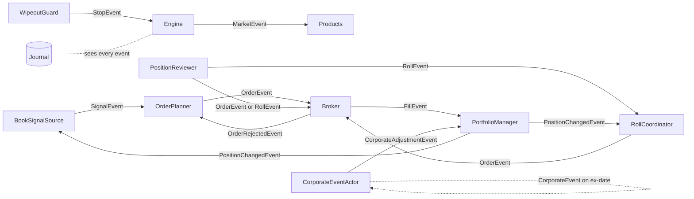

# `event_driven` — Redesign Plan

> **Living document.** Update the progress tracker (§1.11), the decision list (§1.12) and the changelog (Part 2, §M) in the same change as the code they describe.
> Last updated: 2026-11-01 (revision 4) · Status: **planning only, no code written yet**.
>
> Companion: high-level class map in [`CLASS_DESIGN.md`](CLASS_DESIGN.md) (includes later settled choices not yet folded back into this file, including in-backtester data loading with a registerable custom `DataLoader`).

**How this document is organised.**
**Part 1** explains the plan in plain English. Anyone who works with the strategies and results should be able to read it without knowing how the code is written.
**Part 2** is the developer reference: class rules, typing rules, ordering rules, package layout and the technical risks.

---

# Part 1 — The plan in plain English

## 1.1 What we are building

The old `EventDriven` backtester only trades options, and one very large class (`OptionSignalPortfolio`) does most of the work. The simulator is cleaner but only trades stocks and has no realistic fills.

We are building a new package, `trade/backtester_/event_driven/`, that keeps what is good about both:

- From **EventDriven** it keeps the event-first idea (a signal becomes an order, an order becomes a fill), its vocabulary, and its option machinery (`RiskManager`, `OrderPicker`, `PositionAnalyzer`, the cogs and the sizers).
- From **simulator** it keeps the ideas of a `Broker`, an `Account`, a router that decides which signals go through, the daily results objects, and a clear order of events within each day.

It adds three things neither has: a choice between stocks and options (with room for more products), a proper process for corporate events such as splits and dividends, and a clean separation between the portfolio (the information) and the portfolio manager (the one who records changes).

The old `EventDriven` package is **not touched**, because the live trading code depends on it. The new package sits beside it.

## 1.2 Decisions made so far

| Decision | Status |
|---|---|
| "Stocks & equity" means **stocks and options**. | Confirmed |
| **Long-only for now, including stocks.** The engine never holds a short position. | Confirmed |
| A **corporate event process** is part of the design. | Confirmed |
| Code is **heavily typed and uses dataclasses**; ambiguous untyped classes are being phased out. | Confirmed |
| `Portfolio` (information) and `PortfolioManager` (the manager) are **two distinct classes**. | Confirmed |
| **Keep** `RiskManager`, `OrderPicker` and `PositionAnalyzer` (and, by extension, the cogs and legacy sizers). | Confirmed for the first three; the rest assumed (D18) |
| Shared classes use **base classes** (not Protocols), as EventDriven does. | Changed in this revision |
| **Keep EventDriven's language** wherever it fits (names of events, actions, ledger and so on). | Applied in this revision |
| `SystematicMultiAsset` is the **only source of signals**. Other strategy types are converted into one. | Confirmed |

## 1.3 A day in the backtest

For every trading day the engine walks through the same steps in the same order. We call each step a **stage**. Stages are plain steps run by the engine, **not events**.

| # | Stage | What happens |
|---|---|---|
| 1 | Day opens | The engine announces a `MarketEvent` so products can load the day's data. |
| 2 | Corporate events due | Splits, dividends, mergers and similar events whose ex-date is today are applied. |
| 3 | Revalue positions | Every open position is revalued at **today's closing price**. |
| 4 | Safety check | `WipeoutGuard` checks whether the account has been wiped out. |
| 5 | Signals | Delayed signals that are due today are released, and strategies decide today's new signals. |
| 6 | Orders | Signals are approved and turned into orders. Closes are handled before opens. Each order is carried through completely before the next one is considered. |
| 7 | Position review | `PositionReviewer` looks at every open position (stops, rolls, last-day close). |
| 8 | End of day | The books are checked for consistency and the day's snapshot is saved. |

**Why "one at a time" matters.** The book rules (for example a cap on open trades) and the cash check must see the result of the previous order. If three opens arrived at once and were all checked against the same starting cash, the third could overspend. So the order planner hands over one order, the engine carries it through the broker and into the portfolio, and only then does the planner look at the next signal.

**When are positions revalued? (your question 7).** Not in the morning of the next day. The backtest uses one price per day, the close. On day *t* the engine revalues the positions held from day *t−1* using day *t*'s close, and that is simply the first piece of work for day *t*. The signals for day *t* use day *t*'s data too, and with no delay (`tplusn` of 0) the resulting orders fill at day *t*'s close. This is exactly how `Simulator` works today (`mark_to_market(ts)` is the first call inside each day, then the wipeout check, then pending orders, then new decisions). A `tplusn` greater than 0 delays the fill to a later day's close.

## 1.4 The cast: who does what

An **Actor** is one worker with one job. Every Actor is a class that inherits from a common `Actor` base class (§2.A explains why). Each job has its own named subclass.

| Actor | Plain-English job | EventDriven equivalent |
|---|---|---|
| `BookSignalSource` | Asks the strategies (inside `SystematicMultiAsset`) what they want to do today and announces each decision as a `SignalEvent`. Holds delayed signals until they are due. | The strategy object |
| `OrderPlanner` | Takes each signal, decides whether to act on it (using the portfolio-wide book rules), then works out the actual order: which share or option contract, how many, and whether the cash is available. Replaces what I earlier called "Sizer". | `Portfolio.analyze_signal` |
| `Broker` | Receives each `OrderEvent`, works out the fill price including slippage and commission, applies liquidity limits, and reports a `FillEvent`. | `SimulatedExecutionHandler` |
| `PortfolioManager` | The only worker allowed to change the `Portfolio`. Records fills and corporate adjustments, revalues positions, checks the books at day end. | The state-changing half of `OptionSignalPortfolio` |
| `PositionReviewer` | After trading, looks at each open position and decides whether to hold, close, roll or adjust it. For options it asks the existing `PositionAnalyzer`. | `PositionAnalyzer.analyze_position` |
| `RollCoordinator` | Carries out a roll: close the old position, then open the new one, as one connected action. | `execute_roll` and the "walk up the parent events" check |
| `CorporateEventActor` | Reads the list of corporate events for the run and applies each one on its ex-date. | Nothing (new) |
| `WipeoutGuard` | A circuit breaker. If the account equity falls to the floor or below (default zero, as in the simulator), it closes every position and ends the backtest. | Simulator wipeout check |
| `ContractLifecycleActor` | Handles option expiry and exercise (later phase). | `ExerciseEvent` path (broken today) |

Two more pieces are not Actors:

- **`Journal`** is the run's notebook. The scheduler writes every event into it and workers write skip reasons into it. It never creates events.
- **`EventScheduler`** is the single ordered to-do list (see §1.5).

**What is the "bus"? (your question 5).** It was my word for the list that holds everything waiting to be processed and hands it out in a fixed order. EventDriven already calls this idea `EventScheduler` (with an `EventQueue` inside), so the new package uses that name too. In the old version, the order was decided on the fly and could change depending on what had happened; in the new one it is fixed by rule (§2.D).

**What are `StopEvent` and `WipeoutGuard`? (your question 11).** `WipeoutGuard` is the circuit breaker described above. The simulator already has this rule: if equity falls to the floor, close everything and stop, because after that the numbers stop meaning anything. `StopEvent` is the message the guard sends to say "end the backtest after today". It is rarely sent.

**What is `PositionReviewer`? (your question 13).** It is the worker that, once trading is finished for the day, asks "should we still hold each position?" It runs a list of **review rules**: the finalize rule (close everything on the last day), a stop rule, and a rule that wraps the existing `PositionAnalyzer` for options. Every rule answers with the existing EventDriven actions (`HOLD`, `CLOSE`, `ROLL`, `ADJUST`, `EXERCISE`). Exits decided here do not go through the book's approval, because a stop must not be vetoable. By default they execute on the next trading day.

**Where trade size is decided (your question 12).** "How big should this trade be" is decided by the product. For stocks that is the simulator's rule (a fixed size or a percentage of capital, times the signal's leverage multiplier). For options it is the existing `RiskManager.get_order`, which already works with the `OrderPicker` and the legacy sizers (`DefaultSizer`, `ZscoreRVolSizer`). "Can we afford it" is decided by the cash allocator (§1.7). The `OrderPlanner` only joins these steps together, which is why it has a different name from the legacy `Sizer`.

## 1.5 Events: the complete list (your question 4)

**Not everything is an event.** A thing is an event only when it is something that happens in trading and either more than one part of the system cares or we want a permanent record of it. Day stages, "go ahead with the next signal", and status checks are not events. I removed the phase markers, the "admit next" event, the "retry signal" event, and the four separate position events from my earlier draft.

The original EventDriven events are all kept, with the same names and the same meaning.

| Event | Status | Created by | Handled by | Plain meaning |
|---|---|---|---|---|
| `MarketEvent` | Kept | The engine | Products, `Journal` | A new trading day's data is available. |
| `SignalEvent` | Kept | `BookSignalSource` | `OrderPlanner` | A strategy wants to open or close something. Carries `symbol`, `datetime`, `signal_type` (LONG or SHORT), `signal_id`, and for options `max_contract_price` and `order_settings`. |
| `OrderEvent` | Kept | `OrderPlanner`, `PositionReviewer`, `RollCoordinator` | `Broker` | An order for a specific instrument, quantity and `direction` (BUY or SELL). |
| `FillEvent` | Kept | `Broker` | `PortfolioManager` | The broker's report: quantity, fill cost, commission, slippage. Commission is always supplied, which fixes the missing-method problem in the old class. |
| `RollEvent` | Kept | `PositionReviewer` | `RollCoordinator` | Close the current position and open a new one. |
| `ExerciseEvent` | Kept (built in a later phase) | `ContractLifecycleActor` | `PortfolioManager` | An option was exercised. |
| `OrderRejectedEvent` | **New** | `Broker` | `OrderPlanner` | The broker gave up on an order (for example it stayed illiquid past the retry limit). |
| `PositionChangedEvent` | **New** | `PortfolioManager` | `BookSignalSource`, `RollCoordinator`, `Journal` | A position was opened, reduced, closed or adjusted. One event with the detail inside, so strategies stay in step with reality. |
| `CorporateEvent` family: `SplitEvent`, `DividendEvent`, `StockDividendEvent`, `MergerEvent`, `SymbolChangeEvent`, `DelistingEvent`, `SpinOffEvent` | **New** | `CorporateEventActor` (from the data source) | `CorporateEventActor` | Something happened to the company that changes what holders own. |
| `CorporateAdjustmentEvent` | **New** | `CorporateEventActor` | `PortfolioManager` | The result of a corporate event for one position: change quantity, add cash, swap instrument or force a close. |
| `StopEvent` | **New** | `WipeoutGuard` | The engine | End the backtest after today. |

Two names were changed to avoid confusion with EventDriven. The corporate "adjustment" is called `CorporateAdjustmentEvent` because EventDriven's `ADJUST` action already means "change a position's size". The simulator's `SkipEvent` becomes a plain note in the `Journal`, not an event, because nothing reacts to it.



## 1.6 Portfolio and PortfolioManager

| | `Portfolio` | `PortfolioManager` |
|---|---|---|
| What it is | The client's account: what is held, how much cash there is, what has happened. The object you ask questions of. | The steward. The only class allowed to record changes into the portfolio. |
| What it can do | Answer questions (equity, cash, exposure, positions, completed trades, dividend income). Refuse impossible changes. | Apply a fill, apply a corporate adjustment, revalue positions, check the books, and announce each change. |
| What it does not do | It knows nothing about events, the clock, products or other workers. | It does not decide what to trade. |

Everyone else gets a **read-only `PortfolioView`**: a small class that can answer questions but physically has no way to change anything.

The `Portfolio` guards a few always-true rules and stops the run if one is broken:

1. Every position holds a positive quantity (long-only).
2. A sale never exceeds what is held, and never targets a position that does not exist.
3. At most one open position per strategy slot (as in the simulator).
4. Equity equals cash plus the value of all positions.
5. Cash equals starting capital plus every recorded cash movement (so no money can move without a note).
6. Every cash movement has a stated reason, and corporate cash is never recorded as a fill.

These are the same checks that, in the old code, were skipped or silently swallowed.

## 1.7 Cash: shared, or per asset (your question 3)

The simulator uses **one shared pool** of cash. The old EventDriven code splits capital into **one pool per ticker** (`weight_map` gives each symbol a share, and `allocated_cash_map` holds each symbol's dollars; fills debit or credit that symbol's pool, and any unallocated remainder stays aside). The old `Sizer` and `RiskManager` both read the per-ticker cash (`tick_cash`).

We will make this a **plug-in family** called `CashAllocator`, with the choice made by one setting:

| Class | Behaviour |
|---|---|
| `SharedCash` (default) | One pool. Wraps the simulator's `Account`, so buying power, minimum cash and cost handling stay as they are. |
| `CashPerAsset` | One pool per ticker, sized from a weight map (equal weights by default, with the same optional haircut as the old code). A ticker can only spend from its own pool. |

**How hard is it?** Moderate, and it is cheap only if it is built in from the start.

- **Why it is not hard:** the old code already works this way, the concept is simple (a pool per ticker), and nothing else in the design needs to change as long as all cash goes through the allocator.
- **Where the work is:** the portfolio must never touch cash directly; every cash movement is tagged with its pool; the end-of-day check is done per pool; each position remembers which pool funded it; corporate cash goes back to that pool; and "equity of a pool" means pool cash plus the value of the positions it funded.
- **Why now rather than later:** if cash is touched in every fill path before the allocator exists, retrofitting it means changing all of those paths.
- **Things to watch:** cash stranded in an idle pool cannot fund another ticker (same as the old code); a ticker with no weight needs a clear rule (skip with a reason); new tickers mid-run need a policy; moving cash between pools is out of scope.
- **Legacy compatibility:** the old sizers read `allocated_cash_map` from their portfolio object. `CashPerAsset` can supply that exactly. `SharedCash` supplies the same shared figure for every ticker, which is what makes the old sizers usable under either setting.
- **Schedule:** the foundation uses `SharedCash` only, but through the allocator interface. `CashPerAsset` arrives with options (Phase 7), because the old option code expects it and the comparison with old results (Phase 8) needs it.

## 1.8 Products: stocks, options and more

A **product** knows everything specific to one kind of instrument: how to pick the instrument, how to get its prices, how big a trade should be, and how many units a contract covers. The rest of the engine never checks "is this an option?".

| | `StockProduct` | `OptionProduct` |
|---|---|---|
| Signal handling | `LONG` signal buys the stock. A `SHORT` signal is skipped (long-only). | `LONG` buys a call. `SHORT` buys a put. Both are long positions. |
| Choosing the instrument | The ticker. | The existing `RiskManager.get_order`, which uses `OrderPicker`. |
| Trade size | Simulator rule (fixed size or percent of capital, times leverage multiplier). | Existing `RiskManager` with its legacy sizers. |
| Prices | The strategy's own price data (close). | The existing option data (`BacktestTimeseries`). |
| Units per contract | 1 | 100 (applied once, in the cash calculation) |
| Reviewing positions | Finalize and stop rules. | The existing `PositionAnalyzer` and cogs. |

**Choosing the product.** One setting picks the product for the whole run, or a per-ticker or per-sleeve mapping lets stocks and options coexist. **Adding a product** (futures, say) means writing one new product class and registering it. No worker or event changes.

**Keeping the legacy option code.** `RiskManager`, `OrderPicker`, `PositionAnalyzer`, the cogs and the sizers stay as they are. They are wrapped inside `OptionProduct`, `PositionAnalyzerRule` and a small compatibility layer (§2.L) that gives the old sizers the two things they ask of their portfolio object (`allocated_cash_map` and `get_underlier_data`). Everything the old code expects stays inside that wrapper.

## 1.9 Corporate events

A corporate event is something that happens to the company and changes what a holder owns or receives. The process has four parts:

1. **Event objects** describe what happened: a split, a cash dividend, a stock dividend, a spin-off, a merger (cash or stock), a symbol change, or a delisting.
2. A **source** supplies the list of events for the tickers and dates in the run. `NoCorporateEvents` is the default and makes the engine behave exactly like the simulator. `StaticCorporateEvents` is a fixed list for tests. `DataManagerCorporateEvents` reads the existing dividend and split data.
3. A **handler** per event type and product says what to do (scale the quantity, credit cash, swap the instrument, or force a close).
4. The **`CorporateEventActor`** schedules every event on its ex-date, runs the handler, and passes the result to the `PortfolioManager` as a `CorporateAdjustmentEvent`.

Rules worth knowing:

- **Who is entitled.** Events are applied at the start of the ex-date, before any trading that day. A buyer on the ex-date gets nothing; a seller on the ex-date is still paid.
- **No double counting.** If the price data is already adjusted for splits or dividends, applying the event again would count it twice. Each product declares its **price basis** (raw, split-adjusted, or total-return adjusted) and handlers record "not applied, prices already adjusted" instead of changing anything.
- **Options.** A cash dividend on the underlying needs no action for an option holder. Anything else (a split, a merger) follows an **unsupported-event policy**, which by default closes the option at the last known price and records why. Proper option contract adjustment is a later phase.
- **Closed positions and strategies.** A forced close tells the strategy that the position is gone, and cancels any roll in progress.
- **Dividend timing.** By default cash is credited on the ex-date (smooth equity). Crediting on the pay date is more realistic but needs a receivable line; it is a later option.

## 1.10 How strategies get in

`SystematicMultiAsset` is the only signal source. If someone passes something else, a converter turns it into one before the run starts.

| You pass | What happens |
|---|---|
| `SystematicMultiAsset` | Used as is. |
| `MultiAssetStrategy` | Becomes one sleeve; data, start date and `tplusn` are copied; rules already added are re-applied. |
| `StrategyBase` | Becomes a one-ticker sleeve using its own class and `get_bt_params()`. |
| A list of `StrategyBase` | One sleeve per class. |

The converter stops with a clear error if the strategy already holds an open position or has settings that cannot be copied, because the new book always starts from fresh strategy objects. A strategy that produces `SHORT` signals can still be passed in; those signals are skipped on stocks and the skips are logged.

## 1.11 Build order and progress

Each phase must pass its tests before the next one starts. The **foundation** is Phases 0 to 2: a stock-only, long-only engine that reproduces `Simulator` exactly.

| Phase | Name | What it delivers | How we know it is done |
|---|---|---|---|
| **0** | Foundations | Names, base classes, event types, validation, empty scheduler, configuration | Imports work; the type checker passes; shape tests pass |
| **1** | Scheduler and day loop | `EventScheduler`, the eight stages, the calendar | Order is repeatable; weekends and holidays are skipped; parent events can be traced |
| **2** | Stocks end to end | `BookSignalSource`, direct routing, `OrderPlanner`, `Broker` with close fills, `Portfolio`, `PortfolioManager`, `SharedCash`, `StockProduct`, finalize rule, `Journal` | **Same trades and daily equity as `Simulator`** on two long-only test cases; short signals are skipped with a reason; selling something not held stops the run |
| **3** | Book rules and safety | Book routing, `WipeoutGuard`, `StopEvent` | Same results as `Simulator` with a `PortfolioBook` and a cap on open trades |
| **4** | Realistic execution | Quote fills, slippage, commission, liquidity limits, retries, `OrderRejectedEvent`, delayed fills (`tplusn`) | Same seed gives same result; retry limit works; costs match the cash change |
| **5** | Corporate events for stocks | The corporate package, `CorporateEventActor`, all stock handlers, price-basis handling | Hand-built cases give exact quantity, cost basis and cash; entitlement on the ex-date is right; no double counting; Phase 2 still matches the simulator when there are no events |
| **6** | Converters and data source | Conversion of `MultiAssetStrategy` and `StrategyBase`; `DataManagerCorporateEvents` | Converted run equals a hand-built run; real ticker with a known split and dividend produces correct events |
| **7** | Options | `OptionProduct` on the legacy code, compatibility layer, `CashPerAsset`, `PositionAnalyzerRule`, `RollCoordinator`, option corporate policy | A long call and a long put run end to end; cash for a given order matches the legacy engine; a roll swaps positions under one `signal_id`; a split closes the option with a recorded reason |
| **8** | Reporting parity | Trade list with dividend income, attribution, comparison with old results | A written list of expected and unexpected differences |
| **9** | Extras | Expiry and exercise, option contract adjustment for splits, spin-offs, next-open fills, a third product | Written when each item is scheduled |

Progress:

- [ ] Phase 0 — foundations
- [ ] Phase 1 — scheduler and day loop
- [ ] Phase 2 — stocks end to end (**foundation complete**)
- [ ] Phase 3 — book rules and safety
- [ ] Phase 4 — realistic execution
- [ ] Phase 5 — corporate events for stocks
- [ ] Phase 6 — converters and data source
- [ ] Phase 7 — options
- [ ] Phase 8 — reporting parity
- [ ] Phase 9 — extras

## 1.12 Decisions still open

| ID | Question | Recommendation |
|---|---|---|
| D1 | Where do the shared types (`SignalID`, `TradeID`, `PositionEffect`, `SignalTypes`) live? | Keep importing them from `EventDriven.types` for now. Move them only after the old package is retired. |
| D2 | The folder is `event_driven` next to `EventDriven`. Keep? | Yes, and add both to the README table. |
| D4 | Default fill timing for stocks. | Close (matches the simulator). Next-open arrives in Phase 9. |
| D5 | Where do corporate action records and dividend income appear in the result? | Reuse `SimulationResult` and add one optional, typed `extras` field. |
| D7 | What happens when a worker fails? | Stop the run. The old default was to log and carry on, which hid wrong numbers. |
| D9 | What happens to a `SHORT` signal on a stock? | Skip it with a logged reason, so existing strategies keep running. |
| D10 | Default price basis for stock data. | No default: the caller must declare it, so it can never be guessed wrong. |
| D11 | Option behaviour on an unsupported corporate event. | Close at the last price and record why. |
| D12 | Which type checker enforces the typing rules. | The one the repo already uses; otherwise mypy in strict mode. Decide in Phase 0. |
| D13 | Corporate event data: are the dividend dates ex-dates or pay dates? | Read the data layer and confirm before building `DataManagerCorporateEvents`. |
| D14 | Dividend cash timing. | Ex-date by default. |
| D15 | How much of "managing" belongs to `PortfolioManager`? | Stewardship only: record outcomes and keep the books straight. Routing, planning, review and rolls stay with their own workers. The alternative is one larger manager that owns those decisions. |
| D16 | One portfolio per run or several? | One now; `PortfolioId` is already in the model so adding more later is a small change. |
| D17 | When do review exits (stops, rolls) execute? | On the next trading day's close, except the last-day finalize rule, which closes at once. Confirm against the old behaviour in Phase 7. |
| D18 | Are the legacy sizers (`BaseSizer`, `DefaultSizer`, `ZscoreRVolSizer`) kept? | Yes, behind the compatibility layer, since `RiskManager` and the picker depend on them. |
| D19 | Should the validation mixin check every event, or only configuration and records? | Measure the cost in Phase 0, then decide. Until then: validate configuration and rare records, make validation switchable for events. |

---

# Part 2 — Technical reference (for developers)

## A. Class families and base classes

**Why base classes, not Protocols (your questions 1, 9 and 14).** A `Protocol` describes what a class must be able to do, and any class that happens to have those methods qualifies without inheriting anything. I first chose it because it keeps plug-ins independent of our parent class. That reason does not apply here: every worker, product and rule lives in this repository, they share real code (logging, error context, dispatch, reset), and `EventDriven` already uses base classes for exactly this (`Event`, `BaseSizer`, `RMAction`), as does the wider repo (`StrategyBase`, `BaseDataManager`). A base class also lets the engine check at wiring time that a plug-in really is the right kind. So the rule is:

> **Every extension point is an abstract base class. Every concrete implementation inherits from it.** There are no `Protocol` classes in this package.

`Actor` is one general base class. Each named job (`Broker`, `PortfolioManager`, ...) is a subclass of it. Extra intermediate base classes are added only when two subclasses really share code.

| Base class | Subclasses (first release in bold) | What the base provides |
|---|---|---|
| `Event` | **`MarketEvent`, `SignalEvent`, `OrderEvent`, `FillEvent`, `RollEvent`**, `ExerciseEvent`, **`OrderRejectedEvent`, `PositionChangedEvent`, `CorporateAdjustmentEvent`, `StopEvent`**, `CorporateEvent` family | `event_id`, `parent_event_id`, `datetime`, priority class constant, validation |
| `Actor` | **`BookSignalSource`, `OrderPlanner`, `Broker`, `PortfolioManager`, `PositionReviewer`, `WipeoutGuard`, `CorporateEventActor`, `RollCoordinator`**, `ContractLifecycleActor` | `name`, `listens_to`, `start`, `on_stage`, `on_event`, `reset`, module logger, error context |
| `Product` | **`StockProduct`**, `OptionProduct` | Shared checks, price-basis declaration, default "no contract events" |
| `CashAllocator` | **`SharedCash`**, `CashPerAsset` | Pool bookkeeping interface, cash ledger tagging |
| `SignalRouting` | **`DirectRouting`**, `BookRouting` | Closes-before-opens ordering, skip logging |
| `FillModel` | **`CloseFill`**, `QuoteFill` | Cost application, seeded random generator |
| `ReviewRule` | **`FinalizeRule`**, `StopRule`, `PositionAnalyzerRule` | Common result type (`RMAction`) |
| `CorporateEventHandler` | Stock handlers, option handlers | Registry registration, policy lookup |
| `CorporateEventSource` | **`NoCorporateEvents`**, `StaticCorporateEvents`, `DataManagerCorporateEvents` | Date-window filtering |
| `PortfolioView` | (one class) | A read-only wrapper around a `Portfolio`; enforced at runtime, not only by the type checker |

The `Actor` base class:

```python
class Actor(ABC):
    name: str
    listens_to: ClassVar[tuple[type[Event], ...]] = ()

    def start(self, ctx: RunContext) -> None: ...
    def on_stage(self, stage: Stage, ctx: RunContext) -> Iterable[Event]: return ()
    def on_event(self, event: Event, ctx: RunContext) -> Iterable[Event]: return ()
    def reset(self) -> None: ...
```

An Actor's `on_stage` may return a lazy iterator. The engine takes one event, processes everything it causes, and only then asks for the next. That is the "one at a time" rule of §1.3.

## B. Typing standards and the validation mixin (your questions 6 and 8)

| Concern | Rule |
|---|---|
| Records | A frozen `@dataclass` that inherits `FrozenTypeValidationMixin`. Never a bare `dict`, plain `tuple`, or `tuple` subclass (the legacy `ScheduleEntry` is the counter-example). |
| Stateful objects (`Portfolio`, `Account`-like) | A normal `@dataclass` that inherits `DataclassTypeValidationMixin` (construction check only; in-place list edits are guarded by the invariants instead). |
| Categories | A `StrEnum`. No raw strings such as `"stock"` or `"illiquid"` in code. |
| Identifiers | `NewType` aliases for new ids; existing `SignalID` and `TradeID` are reused. |
| Collections inside records | `tuple` or `Mapping`, never `list` or `dict`. |
| Free-form bags | None: no `meta` dictionaries, no `**kwargs` pass-through in public signatures, no `Any` in public APIs. |
| Options | Always `Optional[T]`. |
| Legacy contact | Only inside adapter modules, each returning typed records. |

**How `trade/helpers/helper_types.py` is used.** The file already provides what we need:

- `DataclassTypeValidationMixin` (and its alias `FrozenTypeValidationMixin`) checks every annotated field against its type hint after a dataclass is built, using `typeguard.check_type`, and raises `IncorrectTypeError`. It works for standard and pydantic dataclasses.
- `DataclassAssignmentValidationMixin` adds the same check on later assignments, for mutable dataclasses.
- Every record in this package (events, corporate events and adjustments, instruments, lots, fills, configuration pieces) inherits `FrozenTypeValidationMixin`. Configuration also stays a pydantic dataclass where it enters from users.

Three practical points from reading the mixin:

1. **Do not use `slots=True`.** The mixins have no `__slots__`, so slotted subclasses would still carry a `__dict__`, and the assignment mixin reads `__dict__` directly. The earlier draft's "frozen, slotted" standard is dropped; the rule is simply "frozen dataclass".
2. **Custom checks must call the parent first.** A record with its own rule (for example a lot's quantity must be positive) defines `__post_init__`, calls `super().__post_init__()` to run the type check, and then checks its own rule.
3. **Cost is unmeasured.** `check_type` runs once per field per object, which is cheap for configuration and rare records but may add up for hundreds of thousands of events. Phase 0 includes a small benchmark and a switch so event validation can be turned off for large runs and kept on in tests (decision D19).

**Enforcement.** The type checker runs on the package (D12). A Phase 0 test confirms every record inherits the validation mixin and is frozen, every category is a `StrEnum`, and every `Event` subclass declares its priority.

## C. Names: EventDriven and the new package

| Concept | EventDriven name | Name used here | Note |
|---|---|---|---|
| Event list and queue | `EventScheduler`, `EventQueue` | `EventScheduler` | Same role; one ordered list instead of per-date queues |
| Events | `MarketEvent`, `SignalEvent`, `OrderEvent`, `FillEvent`, `RollEvent`, `ExerciseEvent` | Same | Typed; same field names (`symbol`, `datetime`, `signal_type`, `signal_id`, `direction`, `quantity`) |
| Link to the cause | `parent_event` (object) | `parent_event_id` | An id, not an object, so no walking up chains |
| Strategy direction | `signal_type` (LONG, SHORT) | Same | Earlier drafts said "view side" |
| Order direction | `direction` (BUY, SELL) | Same | Earlier drafts said "order side" |
| Position review result | `RMAction`, `HOLD`, `CLOSE`, `ROLL`, `ADJUST`, `EXERCISE` | Same | Reused as the common result of every review rule |
| Position review | `PositionAnalyzer.analyze_position` | `PositionReviewer` (calls `PositionAnalyzer`) | |
| Signal to order | `Portfolio.analyze_signal` | `OrderPlanner` | |
| Trade record | `Trade`, `TradeLedger` | `TradeLedger` (inside `Portfolio`), `TradeRecord` | |
| Cash per ticker | `weight_map`, `allocated_cash_map` | `CashPerAsset` | |
| Execution | `SimulatedExecutionHandler` | `Broker` | Simulator term |
| Book approval | (none) / simulator `FillRouter` | `SignalRouting` (`DirectRouting`, `BookRouting`) | |
| Option machinery | `RiskManager`, `OrderPicker`, `PositionAnalyzer`, cogs, `BaseSizer` | Same, unchanged | |

## D. How the scheduler orders events

The `EventScheduler` hands out events by the key `(datetime, priority, sequence)`.

| Priority | Events | Reason |
|---|---|---|
| 0 | `FillEvent`, `OrderRejectedEvent`, `CorporateAdjustmentEvent` | Outcomes are recorded first |
| 1 | `PositionChangedEvent` | Strategies and rolls learn the outcome before anything new starts |
| 2 | `OrderEvent`, `RollEvent`, `ExerciseEvent` | Work already in motion finishes before new work |
| 3 | `SignalEvent` | New requests wait |
| 4 | `CorporateEvent` family | Applied at their own stage |
| 5 | `MarketEvent`, `StopEvent` | Announcements |

Within a stage the engine processes events until the scheduler is empty for that day, then moves to the next stage. Future-dated events (delayed signals, corporate events, dividend pay dates, next-day review exits) are placed on their date and appear when the engine reaches that day.

Errors stop the run by default and include the parent-event chain in the message. A logging-only mode is opt-in (D7).

## E. Package layout

```text
trade/backtester_/event_driven/
├── PLAN.md
├── __init__.py              ← public surface: EventDrivenBacktest, EngineConfig, as_book
├── ids.py                   ← NewType ids
├── enums.py                 ← Stage, Direction, SkipReason, PriceBasis, ProductKind, ...
├── events.py                ← Event base and concrete events
├── scheduler.py             ← EventScheduler
├── engine.py                ← EventDrivenBacktest: wires everything, runs the stages
├── config.py                ← EngineConfig and nested configuration records
├── journal.py               ← Journal (the run notebook)
├── adapters.py              ← as_book(): converters into SystematicMultiAsset
├── actors/
│   ├── base.py              ← Actor, RunContext
│   ├── signal_source.py     ← BookSignalSource
│   ├── order_planner.py     ← OrderPlanner
│   ├── broker.py            ← Broker
│   ├── portfolio_manager.py ← PortfolioManager
│   ├── position_reviewer.py ← PositionReviewer
│   ├── roll.py              ← RollCoordinator
│   ├── guards.py            ← WipeoutGuard
│   ├── corporate.py         ← CorporateEventActor
│   └── contract_lifecycle.py← ContractLifecycleActor
├── routing/                 ← SignalRouting, DirectRouting, BookRouting
├── review/                  ← ReviewRule, FinalizeRule, StopRule, PositionAnalyzerRule
├── cash/                    ← CashAllocator, SharedCash, CashPerAsset
├── fills/                   ← FillModel, CloseFill, QuoteFill, slippage, commission, RetryPolicy
├── products/                ← Product, StockProduct, OptionProduct, registry, router
├── legacy/                  ← compatibility layer for RiskManager, OrderPicker, sizers
├── corporate/               ← events, adjustments, handlers, sources, policy
└── portfolio/               ← Portfolio, PortfolioView, positions, TradeLedger, CashLedger, changes, errors
```

Import rules: `ids` and `enums` import nothing from the package. Data-only modules (`portfolio.*`, `corporate.events`, `corporate.adjustments`, `products.base`) import only those two and each other, with no cycles. `Portfolio` never imports the scheduler or any Actor. `engine.py` is the only module that knows every Actor and the only one that holds both the writable `Portfolio` and its `PortfolioView`.

## F. Portfolio details

**Read API** (the `PortfolioView`): `portfolio_id`, `initial_capital`, `cash`, `equity`, `market_value`, `realized_pnl`, `unrealized_pnl`, `income`, `gross_exposure`, `net_exposure`, `long_exposure`, `short_exposure` (always `0.0`), `leverage`, `n_open`, `positions()`, `position_for(strategy_key)`, `holdings_in(symbol)`, `running_pnl(strategy_key)`, `trades()`, `corporate_actions()`, `cash_ledger()`, `context(datetime)` (the object the book's `should_open` and `should_close` hooks read), and `snapshot(...)` (a `DailySnapshot` that `Journal` appends to the reused `DayRecorder` rows).

**Changes** are applied through `apply_fill(fill)`, `apply_adjustment(adjustment)`, `mark(datetime, marks)`, `check_books()` and `reset()`. Each applied change returns a `PortfolioChange` (`Opened`, `Reduced`, `Closed` or `Adjusted`) that the manager announces as one `PositionChangedEvent`. The manager maps change to event with an exhaustive `match`, so a new change type cannot be forgotten.

**Position model.** A position is identified by its strategy slot and `signal_id`, holds one or more lots, and each lot records instrument, quantity (always positive), entry date, entry price, entry costs, roll id and funding cash pool. A roll swaps lots inside one position.

**Missing prices.** `MissingMarkPolicy` decides whether a missing price carries the last price forward (with a warning) or stops the run. The default is chosen in Phase 2 to match the simulator.

**Naming hazards.** The simulator already has `Portfolio` (positions only) and `Broker` (cash, positions and execution together); the old package has `OptionSignalPortfolio`. Always import the new class by its full module path and never import two `Portfolio` names into one module.

**Multiple portfolios.** `ponytail:` one portfolio per run; ceiling is sub-accounts or several clients in one run; upgrade is a mapping of portfolios inside the manager with `portfolio_id` added to fills and adjustments (D16).

**Tests.** The `Portfolio` is tested alone (scripted fills and adjustments, one test per always-true rule, a property test with random valid buys and sells). The manager is tested with a real `Portfolio` and fake events, including that a failing change stops the run and that the end-of-day check runs before the journal reads the portfolio.

## G. Cash allocation details

`CashAllocator` interface: `pool_for(symbol)`, `pool_cash(pool)`, `total_cash`, `cash_by_symbol()` (what the legacy sizers read as `allocated_cash_map`), `fit_open(request) -> approved amount or zero with a reason`, `debit(pool, amount, reason)`, `credit(pool, amount, reason)`, `pool_equity(pool, positions)`, `reset()`.

- `SharedCash` holds one simulator `Account` and uses its trade-size rule, leverage cap, minimum cash and buying-power policy (`SCALE_DOWN` or skip) unchanged, long-side paths only.
- `CashPerAsset` holds one `Account` per symbol, sized as `weight × initial capital × (1 − haircut)`, with unallocated cash left aside as in the old `__construct_weight_map`.
- The `CashLedger` entry carries `pool` and a `CashReason` (`FILL_BUY`, `FILL_SELL`, `COMMISSION`, `DIVIDEND`, `MERGER_PROCEEDS`, `CASH_IN_LIEU`, ...).
- The book's caps and `WipeoutGuard` use total equity. Per-pool wipeout is not planned (`ponytail:` revisit if a ticker's pool going to zero should stop only that ticker).
- Legacy sizers also keep a "starting cash per position id" memory (`USE_CASH_EVERY_NEW_POSITION_ID`). That memory belongs to the sizer and is unaffected by the allocator choice.

## H. Corporate event details

**Event classes** (frozen records, each inheriting `CorporateEvent`, which carries `symbol`, `ex_date` and `source`): `SplitEvent(ratio_new, ratio_old)`, `DividendEvent(amount_per_share, pay_date, is_special)`, `StockDividendEvent(new_shares_per_share)`, `SpinOffEvent(child_symbol, child_shares_per_share, parent_basis_fraction)`, `MergerEvent(acquirer_symbol, exchange_ratio, cash_per_share)` (cash-only is `exchange_ratio` absent), `SymbolChangeEvent(new_symbol)`, `DelistingEvent(last_price, reason)`. Each checks its own numbers (ratios positive, amounts not negative).

**Adjustment classes** (carried inside `CorporateAdjustmentEvent`): `QuantityScale`, `CashCredit`, `InstrumentSwap`, `ForcedClose`, `NewPosition` (placeholder). Each applied or skipped adjustment writes a `CorporateActionRecord` with quantity before and after, cash change, and the skip reason when not applied.

**Handlers.** A `CorporateEventHandler[E]` is a pure function of the event, the held positions in that symbol (from the `PortfolioView`) and the policy. A registry binds (event type, product kind) to a handler. A missing registration follows `UnsupportedEventPolicy`: `RAISE`, `FLAG_AND_CLOSE` or `IGNORE_WITH_WARNING`.

| Event | Stock handler | Option handler |
|---|---|---|
| `SplitEvent` | Scale quantity if prices are raw; record as not applied otherwise | Unsupported policy |
| `DividendEvent` | Credit `qty × amount` unless prices are total-return adjusted | No action |
| `StockDividendEvent` | Scale quantity (as a split) | Unsupported policy |
| `MergerEvent` | Cash: force close at the cash price. Stock: swap instrument at the exchange ratio, credit any cash | Unsupported policy |
| `SymbolChangeEvent` | Swap instrument at ratio 1 (strategy slot unchanged) | Unsupported policy |
| `DelistingEvent` | Force close at `last_price` | Unsupported policy |
| `SpinOffEvent` | Unsupported policy until `NewPosition` is built | Unsupported policy |

**Price basis.**

| `PriceBasis` | Splits | Cash dividends |
|---|---|---|
| `RAW` | Quantity scaled | Credited |
| `SPLIT_ADJUSTED` | Not applied (recorded) | Credited |
| `TOTAL_RETURN_ADJUSTED` | Not applied (recorded) | Not applied (recorded) |

**Sources.** `DataManagerCorporateEvents` is an adapter over `trade.datamanager` (dividend schedules, split factors, raw versus `chain_spot` prices) and the `dividends` and `split_ratio` columns in `trade.helpers.helper`. The legacy `ScheduleEntry` is an untyped `(date, amount)` tuple whose date meaning must be confirmed first (D13).

**Cash timing.** `ponytail:` credit on the ex-date; add a receivable line to the cash ledger if pay-date accuracy matters.

## I. Product details

`Product` interface (abstract methods): `instrument_for(signal, datetime)`, `quote(instrument, datetime)`, `mark(instrument, datetime)`, `trade_size(signal, cash_view)`, `tradable(symbol, datetime)`, `price_basis()`, `contract_events(positions, datetime)` (default none). `Instrument` is one of `StockInstrument` or `OptionInstrument`, each with `contract_size`. Option details sit in a typed `OptionContract` (legacy trade id, expiry, strike, right). Cash flow is `direction_sign × quantity × price × contract_size`, computed in one function and nowhere else.

`OptionProduct` calls `RiskManager.get_order(OrderRequest)`, fills `tick_cash` from the cash allocator, and converts the returned legacy `NewPositionState` into typed instruments and quantities. The legacy code multiplies `tick_cash` by its contract multiplier internally, so the new code must not apply contract size to the same quantity twice. Phase 7 has a test that compares cash for a given order against the legacy engine.

A shared **product conformance test** runs against every registered product: marks exist for held instruments, cash flow signs are correct, instrument choice is repeatable, and quantities are positive.

## J. Strategy conversion details

`as_book(source, options) -> SystematicMultiAsset` is the single entry point (`options` is a typed `AdapterOptions` record).

- `MultiAssetStrategy` uses `Sleeve.from_multiasset`; rules on `asset_strategies[t].rules` are re-applied through `book.set_rules`.
- `StrategyBase` uses `type(s)`, `s.get_bt_params()`, `{s.ticker: s.data}`, `s.start_date`, `s.tplusn`.
- `tplusn` defaults differ (`1` and possibly `None` on the source classes, an integer on the book); the adapter copies the source value and replaces `None` with the engine default, logging the replacement.
- Rule carry-over reads `RuleFilter._rules`, a private list. Preferred fix is a small public accessor on `RuleFilter`; until then the adapter marks the access with a `ponytail:` comment.
- Instance state is discarded. The adapter raises `AdapterError` for open positions or constructor arguments `get_bt_params` does not capture.
- Trades-frame input is not supported.

## K. Configuration

`EngineConfig` is a pydantic frozen dataclass of typed nested records, with no free-form dictionaries.

| Group | Contents |
|---|---|
| Capital | `cash_allocation` (`SharedCash(...)` or `CashPerAsset(weights, haircut)`), initial cash, minimum cash, costs |
| Products | `ProductSelection` (default, by symbol, by sleeve) and one typed config record per product, including `price_basis` |
| Fills | fill model, fill timing, slippage, commission, seed, retry policy |
| Signals | `tplusn` override, `enforce_open_on_signal`, `max_open_retries`, `short_signal_policy` |
| Corporate | source, default price basis, unsupported-event policy, cash timing, fractional-share policy |
| Policy | review rules, whether review exits need approval (default no), wipeout floor |
| Reporting | `record_events`, `validate_events` (D19), error policy (stop by default) |

## L. What we reuse, wrap or drop

| Item | From | Action |
|---|---|---|
| `SystematicMultiAsset`, `Sleeve`, `PortfolioBook`, `PortfolioContext` | `systematic` | Reuse unchanged |
| `Account` | simulator | Reuse inside `SharedCash` and `CashPerAsset` |
| `SimulationResult`, `TradeRecord`, `DailySnapshot`, `DayRecorder` rows, `ResultBuilder` | simulator | Reuse unchanged |
| Simulator `Portfolio`, `Broker`, `ExecutionEngine` | simulator | Do not reuse as classes; the ideas become `Portfolio`, `Broker` actor and `PortfolioManager` |
| `RiskManager`, `OrderPicker`, `PositionAnalyzer`, cogs, `BaseSizer` and its subclasses | `EventDriven` | **Keep unchanged**, wrapped by `OptionProduct`, `PositionAnalyzerRule` and the compatibility layer |
| Compatibility layer | new, in `legacy/` | Gives the old sizers what they ask of their portfolio (`allocated_cash_map`, `get_underlier_data`, `initial_capital`) and nothing else |
| `RMAction` family, `OrderRequest`, `NewPositionState`, option configs, `LiquidityPolicy` | `EventDriven` | Reuse unchanged |
| Event names (`MarketEvent`, `SignalEvent`, `OrderEvent`, `FillEvent`, `RollEvent`, `ExerciseEvent`) | `EventDriven.event` | Recreate as typed classes with the same names and meaning; the old classes stay untouched |
| `SignalID`, `TradeID`, `PositionEffect`, `SignalTypes` | `EventDriven.types` | Reuse (D1) |
| Dividend schedules, split factors | `trade.datamanager`, `trade.helpers.helper` | Wrap in `DataManagerCorporateEvents` |
| Old `EventScheduler` and per-date queues, `new_portfolio`, old `Trade` | `EventDriven` | Not used |

## M. Risks, defects removed, and changelog

**Verified defects in the old engine that the new design removes.**

| # | Defect | Answer |
|---|---|---|
| 1 | `calculate_ib_commission` is called in `event.py` but defined nowhere, so a `FillEvent` without a commission fails | Commission is always supplied by the `FillModel` |
| 2 | The SELL path in `update_positions_on_fill` reads state before checking and does `return ValueError` instead of raising | The `Portfolio` validates first and raises; the manager never swallows errors |
| 3 | `analyze_multiasset_strategy` uses attributes before its `None` check | Conversion happens once, up front |
| 4 | Liquidity failures reschedule an order with no limit | A capped `RetryPolicy`, then `OrderRejectedEvent` |
| 5 | A random number is drawn even when unused, changing results | One seeded generator, drawn only when needed |
| 6 | Module-level caches contaminate runs in one process | No module-level state in the new package |
| 7 | `TradeLedger.update` rebuilds a DataFrame on every entry | The ledger appends to a list and builds the table once |
| 8 | Symbol conflicts are resolved by recursive requeue | A fixed priority rule |
| 9 | Rolls are detected by walking parent events | An explicit `roll_id` and `RollCoordinator` |
| 10 | Cash is split per symbol with no alternative | `CashAllocator` family |
| 11 | `raise_errors` defaults to false | Stop by default |
| 12 | The ×100 contract size is scattered | One cash-flow function (legacy ×100 inside `RiskManager` is tested, not duplicated) |
| 13 | No corporate event handling | The corporate event process |
| 14 | A legacy README that is out of date | This plan |

**Risks.**

| Risk | Impact | Mitigation |
|---|---|---|
| Import cycle between the new package and `EventDriven.types` (also imported by `_strategy.py`) | Import failure | A Phase 0 import test; keep data-only modules free of Actor imports |
| A sequential dependency inside a day that the rules miss | Subtle differences from the simulator | Parity tests in Phases 2 and 3; an ordering test for every new event |
| Legacy option code keeps global state | Runs contaminate each other | Create legacy objects per run; add a "two runs in one process" test |
| The compatibility layer grows beyond what the old sizers need | A second portfolio class by stealth | It exposes a fixed short list of attributes; additions need a plan entry |
| Splits or dividends counted twice | Wrong quantity, cash and profit | Declared price basis, "not applied" records, a no-double-counting test |
| Ambiguous dividend dates | Wrong entitlement day | Confirm date meaning (D13); keep `StaticCorporateEvents` for tests |
| A short signal reaching a stock sleeve | A position the engine cannot represent | Skip with a reason; the portfolio raises if one slips through; both tested |
| Options through a split without contract adjustment | Marks jump, equity wrong | Default close-and-record until Phase 9 |
| `Simulator` supports shorts, `event_driven` does not | False parity failures | Parity cases use long-only strategies |
| Validation cost on large runs | Slow runs | Benchmark in Phase 0; switchable (D19) |
| Name confusion with the simulator's `Portfolio`/`Broker`/`SkipEvent` and old `EventScheduler` | Wrong class imported | Import by full module path; tests import both and assert they differ |
| Live repos broken by accident | Production risk | No edits under `EventDriven/`; an import check for the live entry points |

**Changelog.**

| Date | Change |
|---|---|
| 2026-11-01 | Plan created from a full read of `EventDriven` and `simulator`. |
| 2026-11-01 | Revision 2: long-only invariant, corporate event process, typing standards, phases renumbered. |
| 2026-11-01 | Revision 3: `Portfolio` (information) and `PortfolioManager` (steward) as two classes. |
| 2026-11-01 | Revision 4: restructured into a plain-English Part 1 and a developer Part 2. Protocols replaced by base classes everywhere. Phase markers, `AdmitNext`, retry and skip events removed; the complete event list now reuses all six EventDriven events. "Bus" replaced by `EventScheduler`. `Sizer` renamed `OrderPlanner`; trade size is decided by the product and the legacy sizers, affordability by `CashAllocator`. `ReviewActor` renamed `PositionReviewer` and built on `PositionAnalyzer` and the existing `RMAction` family. `CashAllocator` family added (`SharedCash`, `CashPerAsset`). Legacy `RiskManager`, `OrderPicker`, `PositionAnalyzer`, cogs and sizers kept behind a compatibility layer. Validation mixin guidance added, and `slots=True` dropped from the standard. Decisions D17 to D19 added. |
